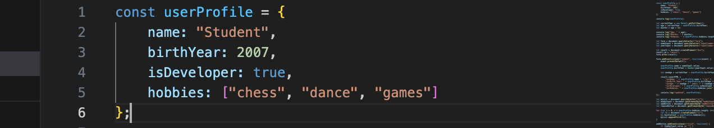
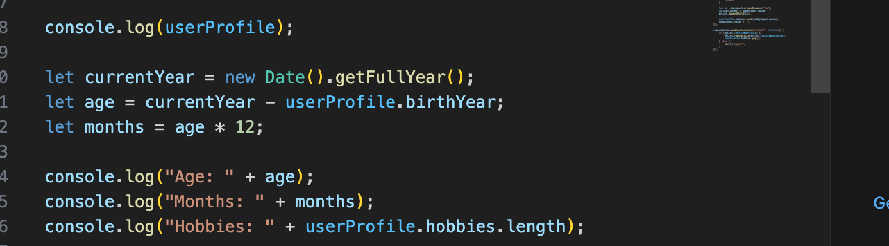
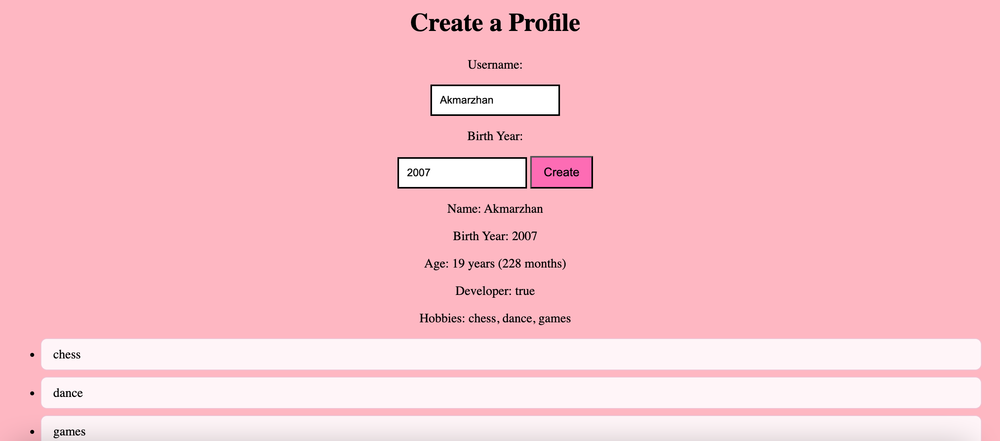
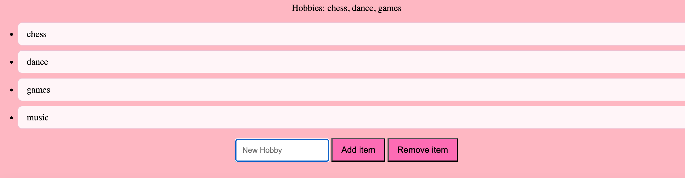

# Assignment 5 - Frontend

Name: Akmarzhan Nurtas
Group: SE-2538

## Task 1: Personal Info Object

I made a const object called userProfile. It has name (string), birthYear (number), isDeveloper (boolean) and hobbies (array).

## Task 2: Arithmetic Calculations

I calculated age using current year minus birthYear. Also I calculated months (age * 12) and hobbies count. I showed them in console.

## Task 3: HTML Form Setup

I made a form with Username input, Birth Year input and a Create button.

## Task 4: Event Listener

I added submit event listener on the form. When user clicks Create, it takes the input values, updates userProfile object and shows the info on the page.

## Task 5: Creating & Removing Elements

I made a list for hobbies. The "Add item" button creates new li element. The "Remove item" button removes the last li from the list.

## Summary

First I made the userProfile object and did the calculations in console. Then I built the form and added event listener to update the object. After that I made the list with add and remove buttons using createElement, appendChild and removeChild. I tested everything in the browser and checked console for errors. Everything works.